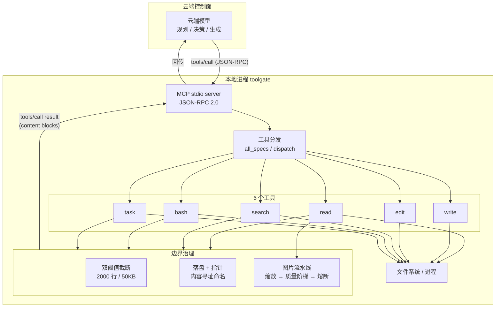

# toolgate 架构设计

> 端云协同的本地工具层。云端模型做规划，本地进程做执行，
> 两者之间用 MCP 通信，上下文按「够用就好」的规则裁剪。

本文档是可执行架构的唯一权威描述。代码在 crates/ 下，两者不一致时以代码为准，
并把文档改过来。

---

## 0. 一句话说清它是什么

toolgate 是一个**本地常驻的 MCP server**，向云端 agent 暴露 6 个工具
（read / write / edit / search / bash / task），并在工具边界上做三件事：

1. **把大输出挡在上下文之外**——超限内容落盘，只回传指针；
2. **把附件压到模型能吃的尺寸**——图片多级降级压缩，超限则省略并说明；
3. **把不确定性变成显式失败**——编辑锚点失配、命令超时、二进制文件，
   都返回可读的错误而不是猜。

它不实现 agent 循环，不实现会话存储，不绑定任何模型厂商。
这些都在云端那一侧，toolgate 只管「手脚」。

---

## 1. 先修正前提：原设计里六处站不住的说法

在动手之前，必须把原文档里的事实性错误列清楚。这些错误会直接影响
实现决策——按错的描述去写代码，会写出没人需要的功能。

### 1.1 「基于 rpi 构建」——半错

原文档写「Rust Core，基于 rpi 构建」。实测：

- 本机 ~/.local/bin/rpi 是个 bash 脚本，注释为「pi_agent_rust installer
  managed alias」，末行 exec ~/.local/bin/pi-rust，而**该二进制不存在**。
- 但项目本身是真实的：Dicklesworthstone/pi_agent_rust，1959 stars，
  MIT + Rider，零 unsafe，最近推送 2026-11-03。
- 另有同名易混项目 bigfish1913/pi-rust，198 stars，**它的二进制才叫 rpi**，
  并且提供 rpi-plugin-sdk（稳定 plugin ABI，可编 cdylib）。

**结论**：本机安装残缺，不是项目不存在。但 toolgate 决定**不基于任何
既有 agent 框架构建**——理由见 1.6。上述两个项目作为参考，不作为地基。

### 1.2 「哈希锚点（LINE#HASH）是 Pi 风格特性」——错

pi 全量检索无 hashline 实现。该机制真实存在，但出处是 **oh-my-pi fork**：

- pi 官方 discussion #5474 原话：「I saw this concept implemented in the
  oh-my-pi fork」；
- 生态实现：pi-hashline-edit-pro、@piex-dev/hashline、DSH 的 dsh-better-edit；
- 反证：Claude Code issue #25775，state=CLOSED，stateReason=NOT_PLANNED。

**结论**：hashline 是有据可依的生态实践，但不是 pi 特性。toolgate 保留它，
定位为**可选模式**，默认关闭，理由见 §4.3。

### 1.3 「Apply Patch 扁平文本」——错

pi 的 edit 输入是结构化的 {path, edits:[{oldText,newText}]}。
unified patch 是**输出**（details.patch），模型从不提交 patch 文本。

**结论**：toolgate 的 edit 也用 oldText/newText，不做扁平 patch 输入。
真正要消灭的是「转义摩擦」，而它靠的是**匹配容错**（引号、破折号、
行尾空白归一化）而不是换输入格式。

### 1.4 图片参数三处错

原文档：最长边 1568px → WebP 优选 → 质量 85/70/55/40 → 1.2MB 熔断。

pi 实测（dist/utils/image-resize-core.js:8-15）：

    maxWidth: 2000, maxHeight: 2000,
    maxBytes: 4.5 * 1024 * 1024,   // 量的是 base64 文本长度
    jpegQuality: 80

- 输出格式只有 **PNG / JPEG**，webp 仅作为输入被识别，不产出；
- 质量阶梯是 [80, 85, 70, 55, 40]（去重后）。

**结论**：原文档的 1568 / WebP / 1.2MB 都不是 pi 的取值，而是**独立的设计
选择**。toolgate 采纳它们，但要在文档里说明是自选而非继承——见 §5。

### 1.5 「多级压缩」与「无损输出治理」——部分错

- pi 的 compaction **不是多级**，是两种并列机制：阈值压缩 + 分支摘要。
  且压缩是**追加**一条摘要 entry，原始数据仍在会话树里
  （compaction.md:83：「Omitted raw entries remain stored」）。
- pi 的 read 工具截断后**不落盘**，只给 offset 续读提示；只有 bash 落盘。

**结论**：toolgate 的治理规则按「内容在哪」分治，不搞统一落盘——见 §6。

### 1.6 「Pi 风格 = 极简工具集」——这个前提本身要质疑

实测主流 agent 的工具数：

| 产品 | 工具数 | 备注 |
|---|---|---|
| pi | 8 | read/bash/powershell/edit/write/grep/find/ls |
| Gemini CLI | 约 20 | |
| Codex CLI | 约 16 | |
| Claude Code | **46** | 且专门设了 ToolSearch 工具 |

**不存在「工具集收敛」的行业趋势**。Claude Code 的做法是扩张 + 用工具搜索
解决可发现性。所以「极简」不是一个普适最优解，而是一个**有代价的取舍**。

toolgate 选 6 个工具的理由不是「越少越好」，而是三条具体约束（见 §4.1）。
如果换一个场景（比如本地全权 agent，无缓存压力），这个数字应该重算。

### 1.7 CacheRouter 被误用

原文档把「CacheRouter 理念」当作端云协同的依据。核实：

- 论文真实存在：arXiv:2608.22708，2026-08-24；
- 核心是「主模型只暴露固定少量工具以保持前缀稳定 → 命中 prompt cache，
  长尾工具交给路由子模型」，实测缓存命中率 90.99% / 95.2%；
- **通篇没有端云分工论述**，且是单篇预印本，证据强度弱。

**结论**：CacheRouter 只能支撑「工具声明必须稳定」这一条，不能支撑
「端云协同」。toolgate 的工具表因此设计成**编译期固定、字节稳定**（§4.4）。

### 1.8 LFM3 名称需精确

- 真实存在，2026-10-27 发布，开放权重；
- 视觉版叫 **LFM3-VL-2B**（1.92B），不叫 LFM3-VL；
- 「快思考路由 d1」对应 **d1-2B**（1.92B）；
- 许可证是 **LFM Open License v1.0**，不是 Apache/MIT，商用前需读条款；
- 官方提供 GGUF / MLX / ONNX / FP8 / NVFP4 变体，llama.cpp 与 MLX 均可跑。

---

## 2. 核心命题

修正前提之后，这套架构真正主张的东西只剩三条。每条都可以被证伪。

### 命题一：工具输出必须按「内容在哪」分治，而不是统一落盘

文件内容已经在磁盘上，再落一份副本是浪费；命令输出只存在于进程管道里，
不落盘就永久丢失。所以：

- read 截断 → 给 offset 续读提示，**不落盘**；
- bash / task 截断 → 完整内容落盘，回传指针；
- search 截断 → 落盘（结果无法重现，重跑可能得到不同集合）。

这条直接来自 pi 的实际做法，且比原文档的「统一落盘」更省。

### 命题二：缓存保护靠「工具表字节稳定」，不靠「工具少」

云端模型的 prompt cache 以请求前缀为键。工具声明在请求里，一旦顺序或
字段抖动，整个前缀失效。

所以 toolgate 保证：

- 工具顺序固定（read/write/edit/search/bash/task，写死在 all_specs()）；
- 工具描述与 schema 是编译期常量，不随环境变化；
- 版本升级导致 schema 变化时，serverInfo.version 同步变化，客户端能察觉。

至于工具数量，它影响的是**每轮请求的固定开销**，不是缓存命中。6 个工具
的 schema 合计约 1.5KB，相对于 200K 上下文可忽略。

### 命题三：不确定性必须显式失败，不能猜

三处具体实现：

- 编辑锚点失配 → 拒绝写入并提示重新 read（而不是模糊匹配到最近的行）；
- oldText 匹配到多处 → 报错要求扩大上下文（而不是改第一处）；
- 命令超时 → 终止并报超时（而不是返回半截输出装作成功）。

代价是多一轮往返。收益是错误不会静默传播——对 agent 来说，一次明确的
失败比一次错误的成功便宜得多。

---

## 3. 系统全景



三条链路值得单独说明：

**链路一：工具调用**。云端发 tools/call，本地执行，结果按 MCP content block
返回。没有额外的协议层——toolgate 不做自己的 RPC，直接用 MCP。

**链路二：输出治理**。截断与落盘发生在工具返回**之前**，在进程内完成。
云端永远看不到完整的大输出，只看到裁剪版 + 指针。这是「上下文极简」的
落点，也是唯一有效的落点：等输出到了云端再裁，token 已经花掉了。

**链路三：附件处理**。图片在 read 工具内部被解码、缩放、重编码，
产出标准 MCP image block。云端模型看到的是已经压缩好的版本。

### 3.1 为什么不做 PTC

DSH 的 PTC（run_code）把工具调用嵌进 TypeScript 程序里，子调用不进模型
历史，只把脚本输出送回去。这个设计很强——它一次解决了上下文、并发、
批量三个问题。

toolgate **不实现 PTC**，原因是分工不同：

- PTC 是**调用侧**的优化，属于 agent 循环的一部分；
- toolgate 是**执行侧**，它不需要知道调用方是一次一次调还是批量调。

两者可以叠加：DSH 用 PTC 调 toolgate，toolgate 照样按工具边界治理输出。
事实上这正是推荐的组合方式（见 §11）。

---

## 4. 工具集：6 个工具，以及为什么是这 6 个

### 4.1 收敛到 6 个的三条约束

不是「越少越好」。是三条具体约束把它们筛出来的：

**约束 A：缓存前缀要稳定。** 工具表在请求里，抖动即失效。所以工具应该
覆盖高频动作，低频动作走组合而不是新增工具。

**约束 B：治理规则要集中。** 每条治理规则只在一个工具里实现，避免
「同样的截断逻辑抄五份，改一处漏四处」。

**约束 C：语义边界要清晰。** 两个工具职责重叠时，模型会选错。宁可合并
（grep + find → search），也不留重叠。

### 4.2 六个工具

| 工具 | 职责 | 关键行为 | 对应 pi |
|---|---|---|---|
| read | 读文本/图片 | 行号；超限给 offset；图片走压缩 | read |
| write | 新建/整体覆盖 | 自动建父目录 | write |
| edit | 局部修改 | 双模式：文本匹配 / 行锚点 | edit |
| search | 内容检索 + 文件枚举 | mode=content/files；超限落盘 | grep + find 合并 |
| bash | 一次性命令 | 拒绝 shell 字符串；尾部截断 + 落盘 | bash |
| task | 后台长任务 | start/read/kill/list | **pi 没有** |

三处与 pi 的差异，都有明确理由：

**search 合并了 grep 与 find。** pi 分开两个工具。合并的理由是约束 B——
两者的「超限落盘」逻辑完全一样，分开放会抄两份。代价是 mode 参数多一个，
但 schema 描述里写清了取值。

**bash 只接受数组参数。** pi 的 bash 接受命令字符串（走 shell）。toolgate
拒绝，因为字符串形式必然经过一层 shell 解析，引号、通配符、变量展开都是
注入面。数组形式直接 execve，没有解析层。代价是管道与重定向要拆成多次
调用——这个代价是可接受的，因为 agent 本来就应该用程序而不是 shell 拼串。

**task 是新增的。** pi 没有后台任务工具（tools/index.js 只有 8 个，检索
run_in_background 零命中）。但「启动开发服务器然后继续干别的」是真实需求，
DSH 用 job_* 三个工具覆盖。toolgate 用一个工具的 4 个 action 覆盖，
按约束 A 省两个工具位。

### 4.3 edit 的两种模式

**模式 A：文本匹配（默认）**

入参 edits:[{oldText, newText}]。匹配顺序：

1. 精确匹配，命中唯一则替换；
2. 命中多处 → 报错，要求扩大上下文使其唯一；
3. 未命中 → 归一化后再匹配（智能引号、Unicode 破折号、特殊空格、
   行尾空白）；
4. 归一化仍多处或零处 → 报错。

这个顺序直接借鉴 pi 的 edit-diff.js：真正让模型少失败的不是换个输入格式，
而是**匹配容错**。

**模式 B：行锚点（可选，默认关闭）**

read 带 anchor:true 时，每行输出 行号#4位哈希│内容。
edit 传 anchor:"12#f8a2" + newText，校验该行哈希后才替换。

存在的意义只有一个：**大文件反复编辑时省 token**。oldText 可能要回传
50 行原文，而 12#f8a2 只有 7 个字符。

代价是 read 时每行多约 7 字节。所以判据是：

- 单文件 > 500 行，且预计反复改其中少量行 → 值得开；
- 小文件、一次性编辑、整段重写 → 用文本匹配更省。

这个取舍必须写在工具描述里，否则模型会无脑开锚点，反而更费。

### 4.4 工具表的字节稳定性

all_specs() 返回固定顺序，schema 是编译期常量。升级时：

- 新增工具 → 追加到末尾，不改已有顺序；
- 改 schema → 必须同时改 serverInfo.version。

客户端（如 DSH 的 tool-result-pruner）依赖这个稳定性做缓存。

---

## 5. 附件处理流水线

### 5.1 三个阶段

**阶段一：类型嗅探**

读文件前 4KB，按魔数判定：

| 魔数 | 类型 |
|---|---|
| 89 50 4E 47 0D 0A 1A 0A | image/png |
| FF D8 FF | image/jpeg |
| GIF87a / GIF89a | image/gif |
| 52 49 46 46 .. .. .. .. 57 45 42 50 | image/webp |
| 42 4D | image/bmp |

不是图片则检查二进制：前 8KB 出现 NUL 字节即判为二进制，拒绝按文本读，
并提示用 bash 调专用工具。

**阶段二：图片多级降级压缩**

```text
解码
  ↓
已达标（尺寸 ≤ 1568 且 base64 ≤ 1.2MB 且格式是 png/jpeg/webp）
  → 原样透传，不重编码（避免二次损失）
  ↓ 未达标
按最长边等比缩放到 1568
  ↓
有透明通道 → 先试 PNG
  ↓ 超限
有损 JPEG：质量 85 → 70 → 55 → 40
  ↓ 全部超限
最长边 ×0.75，回到缩放步骤（最多 3 轮）
  ↓ 仍超限
熔断：不塞进上下文，返回文本说明 + 原图路径
```

**为什么 1568 而不是 pi 的 2000**：主流视觉编码器的训练分辨率上限在
1568 附近，再大通常只是增加 token 而不提升识别质量。这是自选参数，
不是继承 pi。

**为什么没有 WebP 输出**：Rust 的 image crate 的 WebP 编码器**只支持无损**，
有损 WebP 需要绑定 libwebp。为了不引入 C 依赖，当前版本输出 PNG/JPEG。
有损 WebP 列为后续可选项（§11）。

**阶段三：内容寻址去重**

图片编码后计算 SHA-256，随 image block 一起返回（放在 structuredContent 的
imageHash 字段，不放 content 里——imageHash 不属于 MCP 规范，见 §9.3）。
同一张图在多轮对话里重复出现时，客户端可以据此复用，不重复消耗视觉 token。

### 5.2 熔断不是失败

压缩到极限仍超限时，返回的是**成功的工具调用**（isError=false），
内容是一段文本说明 + 原图路径。

理由：对 agent 来说，「这张图太大我没法看，但它在 /tmp/x.png」是一个
可行动的信息；而「工具报错」会让它重试或放弃。

---

## 6. 输出治理

### 6.1 双阈值

两个独立上限，先到先触发（crates/toolgate-core/src/truncate.rs）：

- 行数 2000
- 字节 50KB

永不返回半行。唯一例外是尾部截断时末行本身超限，此时返回该行的尾部
若干字节并标记 last_line_partial。

### 6.2 按内容位置分治

| 工具 | 截断方向 | 是否落盘 | 理由 |
|---|---|---|---|
| read | 头部 | 否 | 文件在磁盘上，给 offset 即可续读 |
| search | 头部 | 是 | 检索结果不可重现，重跑可能不同 |
| bash | 尾部 | 是 | 错误栈与最终结果在尾部；输出只存在于管道 |
| task | 尾部 | 是 | 同上 |

这张表是命题一（§2）的直接实现。原文档的「统一落盘」在这里被否决，
因为它对 read 是纯粹的浪费。

### 6.3 落盘命名

内容寻址（crates/toolgate-core/src/spill.rs）：

```text
<系统临时目录>/toolgate-spill/<kind>-<sha256 前 16 位 hex>.log
```

相同内容重复落盘不会产生多份副本。这与 pi 的做法不同——pi 用随机 hex
（output-files.js:16 用 randomBytes(8)），每次都是新文件。内容寻址的
代价是「想按时间顺序翻日志」不方便，收益是磁盘不会因为重跑同一条命令
而膨胀。对 agent 场景，后者更重要。

### 6.4 指针的形态

落盘后回传的是**一行人类可读的提示**，不是结构化字段：

```text
[输出已截断：共 8421 行 / 2.1MB，仅展示尾部 2000 行。
 完整输出已落盘：/tmp/toolgate-spill/bash-a8f5f167f44f4964.log（8421 行 / 2.1MB），
 需要时用 read 按段读取。]
```

结构化信息同时放在 structuredContent 里（不进模型上下文），供程序化判断。

### 6.5 与 DSH 的两层治理的关系

DSH 在工具执行之后还有两层（spill-policy 12500 token + tool-result-pruner
8192 字符）。toolgate 的治理发生在**工具内部**，早一层。

两者叠加时不会冲突：toolgate 已经把输出压到 2000 行以内，DSH 的两层
通常不会触发。这是有意的——把治理放在离数据最近的地方，下游各层就都
轻了。

---

## 7. 多模态协商

### 7.1 三种情形

| 情形 | 处理 | 产出 |
|---|---|---|
| 模型支持视觉 + 图不复杂 | 压缩后原样透传 | image block |
| 模型支持视觉 + 图过大 | 压缩到极限仍超限 | 文本说明 + 路径 |
| 模型不支持视觉 | 需要 OCR 降级 | 由调用方决定 |

### 7.2 toolgate 不判断模型能力

这是刻意的边界。toolgate 是执行侧，它不知道也不该知道对面是哪个模型。

「模型是否支持视觉」由**调用侧**判断：

- DSH 的做法：读 llm.resolveModelInfo() 的 inputModalities，含 image 则
  视觉路由，否则转 OCR（dsh-image-text 插件，lib/index.js:746-758）；
- pi 的做法：模型配置里的 inputLimits.images，缩放参数是模型级配置。

toolgate 提供的是「压到标准尺寸」这件事本身，任何模型都能接。

### 7.3 能力感知的正确位置

如果要实现「主模型不支持视觉就自动 OCR」，正确的位置是**调用侧中间层**，
不是工具层。因为工具层拿不到模型信息，硬塞进去只会变成又一个配置项。

toolgate 的 read 只做一件事：把图变成符合 MCP 规范的 image block。
是否使用它，是调用方的决定。

---

## 8. 边界：什么归工具层，什么不归

这张表是防止架构膨胀的主要手段。任何新功能先问：它归哪一层？

| 能力 | 归属 | 理由 |
|---|---|---|
| 工具执行 | **toolgate** | 它就是干这个的 |
| 输出截断与落盘 | **toolgate** | 必须发生在数据离开本地之前 |
| 图片压缩 | **toolgate** | 同上 |
| 编辑锚点校验 | **toolgate** | 属于工具语义 |
| agent 循环 | 调用侧 | toolgate 不知道「下一步该干什么」 |
| 会话存储 | 调用侧 | 见 8.1 |
| 检查点 / 断点续传 | 调用侧 | 见 8.1 |
| 上下文压缩（compaction） | 调用侧 | 需要看整个对话，工具层只看见单次结果 |
| 模型能力判定 | 调用侧 | 见 §7.2 |
| 提示词构造 | 调用侧 | toolgate 不生成 prompt |

### 8.1 为什么 checkpoint 不归工具层

原文档把「断点续传：达到步数上限未完成，保存 checkpoint_id 返回 partial」
放在 Rust 引擎里。这个设计有内在矛盾：

- 「步数上限」是**agent 循环**的概念，工具层看不到步数；
- 「未完成」需要知道**目标是什么**，工具层只知道「这条命令跑完了」；
- 「续传」需要恢复**上下文状态**，而工具层是无状态的。

所以检查点属于会话层。DSH 的实现印证了这点：session-checkpoint-policy
在 llm/stream、tools/execute、agent/pre-step 三个边界调 flush，
是**会话层**的职责，且 fail-closed（checkpoint 失败则不派发下游请求）。

toolgate 的 task 工具只保证「进程可寻址、输出可增量读取」，
不假装自己能续传。

### 8.2 原文档里应该删掉的两项

**「本地 LFM3 清洗日志提取 JSON 摘要」**。让一个 2B 模型在工具返回路径上
做摘要，引入三个问题：延迟（每次大输出都要推理）、不确定性（同一份日志
两次摘要不同）、依赖（本地模型不可用时整条链路降级）。

如果确实需要日志摘要，正确位置是调用侧的 compaction——那里本来就要调
模型，顺手做摘要不增加额外开销。

**「快思考路由 d1」**。工具分发是确定性的：按名字 match。没有需要「思考」
的环节。如果指的是「决定用哪个工具」，那属于模型侧，不在本地。

---

## 9. 接口契约

### 9.1 MCP 协议版本

支持 2026-07-28（首选）、2025-11-25、2025-06-18。initialize 时按客户端
请求的版本协商，不匹配则回落到最新支持版本。

### 9.2 tools/call 返回

```json
{
  "jsonrpc": "2.0",
  "id": 7,
  "result": {
    "content": [
      { "type": "text", "text": "已截断，完整内容落盘：/tmp/..." }
    ],
    "isError": false,
    "structuredContent": {
      "truncated": true,
      "spill": { "path": "/tmp/...", "lines": 8421 },
      "exitCode": 0
    }
  }
}
```

**工具级错误走 isError，不走 JSON-RPC error**。区别很重要：JSON-RPC error
会让客户端认为协议层出问题，可能重试或断开；isError 是工具返回的正常结果，
模型能看到错误文本并自行修正。

只有协议层问题（未知方法、JSON 解析失败）才用 JSON-RPC error。

### 9.3 image block 的字段

MCP 规范（2026-07-28 schema L2340）定义的 ImageContent：

```json
{ "type": "image", "data": "<base64>", "mimeType": "image/webp" }
```

**注意**：原设计文档里多出的 imageHash 字段**不属于 MCP 规范**。
toolgate 把它放在 structuredContent.imageHash，不放进 content——
放进去会让严格的客户端校验失败。

### 9.4 工具入参 schema 的约定

- 必填参数一律放在 required 数组；
- 每个参数有 description，写清「是什么」和「什么时候用」；
- 枚举参数列出全部取值（如 mode: content | files）；
- 有默认值的参数在 description 里写明默认值。

这些不是风格偏好，是为了让模型能一次选对（见 agent-tool-design 的判据）。

---

## 10. 实现状态

截至本次提交，仓库里已经能跑的东西：

| 模块 | 文件 | 状态 |
|---|---|---|
| 双阈值截断 | crates/toolgate-core/src/truncate.rs | 完成，5 个测试 |
| 内容寻址落盘 | crates/toolgate-core/src/spill.rs | 完成，2 个测试 |
| 行锚点 | crates/toolgate-core/src/hashline.rs | 完成，8 个测试 |
| 类型嗅探 | crates/toolgate-core/src/media/mod.rs | 完成，5 个测试 |
| 图片压缩流水线 | crates/toolgate-core/src/media/image_pipeline.rs | 完成，3 个测试 |
| read | crates/toolgate-core/src/tools/read.rs | 完成，3 个测试 |
| write | crates/toolgate-core/src/tools/write.rs | 完成，1 个测试 |
| edit | crates/toolgate-core/src/tools/edit.rs | 完成，6 个测试 |
| search | crates/toolgate-core/src/tools/search.rs | 完成，3 个测试 |
| bash | crates/toolgate-core/src/tools/bash.rs | 完成，2 个测试 |
| task | crates/toolgate-core/src/tools/task.rs | 完成，2 个测试 |
| MCP 传输 | crates/toolgate-mcp/src/lib.rs | 完成，5 个测试 |
| CLI | crates/toolgate-cli/src/main.rs | 完成 |

验证方式：

```bash
cargo test          # 41 个测试
cargo build         # 零警告
./target/debug/toolgate list
./target/debug/toolgate call read '{"path":"Cargo.toml","limit":5}'
```

端到端可验证：把 toolgate serve 挂到任何 MCP 客户端上，6 个工具即可用。

---

## 11. 路线图

### 已完成（v0.1）

- 6 个工具 + MCP stdio 传输
- 双阈值截断、按内容位置分治、内容寻址落盘
- 图片压缩流水线（缩放 → PNG/JPEG 质量阶梯 → 尺寸兜底 → 熔断）
- 行锚点（可选模式）

### 下一步（v0.2）

**1. 有损 WebP 输出**

当前受限于 image crate 只支持无损 WebP。方案：可选 feature 绑定 libwebp，
或在外部通过 ffmpeg 子进程编码。收益是同质量下体积降到 JPEG 的六到七成。

**2. task 的进程组管理**

当前 kill 只杀直接子进程。开发服务器通常会派生子进程，杀不干净。
方案：Unix 下用 setsid 建新进程组，kill 时杀整组。

**3. search 的并行遍历**

当前是单线程遍历。大仓库下慢。方案：用 ignore 的并行 walker。

### 后续（v0.3+）

**4. 流式输出**

当前 bash 要等命令结束才返回。长命令（如构建）期间模型看不到进度。
方案：参考 pi 的 OutputAccumulator，边读边累积，超限即落盘。

**5. HTTP 传输**

当前只有 stdio。远程场景需要 streamable HTTP。

**6. 本地小模型接入（可选）**

如果要在本地做 OCR 或日志摘要，接入 LFM3-VL-2B 或 d1-2B。
**但注意**：这两项按 §8.2 的论证，更合适的位置是调用侧。所以这一项
优先级最低，除非有明确的本地化需求（如数据不能出本地）。

### 明确不做

- agent 循环
- 会话存储与检查点
- 上下文压缩
- 提示词构造
- 模型路由

理由见 §8。

---

## 12. 参考与证据

### 一手代码

- pi：@earendil-works/pi-coding-agent，dist/core/tools/*.js，dist/utils/image-resize-core.js
- DSH：@deepseek-ai/dsh-tool-*，packages/core/tool-executor-ptc/src/ts-types.ts

### 论文与规范

- CacheRouter：https://arxiv.org/abs/2608.22708
- MCP 规范：https://modelcontextprotocol.io/specification/2026-07-28/server/tools
- LFM3：https://www.liquid.ai/blog/lfm3

### 生态实践

- pi hashline discussion：https://github.com/earendil-works/pi/discussions/5474
- Claude Code 拒绝 hashline：https://github.com/anthropics/claude-code/issues/25775
- Claude Code 工具表：https://code.claude.com/docs/en/tools-reference

### 本仓库的调研笔记

- docs/research-notes-pi.md：pi 源码实测结论
- docs/research-notes-dsh.md：DSH 机制实测结论
- docs/research-notes-external.md：外部事实核实

---

## 附录 A：与原设计文档的逐条对照

| 原设计 | 本文档 | 原因 |
|---|---|---|
| 基于 rpi 构建 | 不基于任何框架 | 本机残缺；且框架耦合违背中立目标 |
| 哈希锚点是 Pi 特性 | 是 oh-my-pi 起源的生态实践，自选可选模式 | 事实修正 |
| Apply Patch 扁平文本 | 不做，用 oldText/newText + 匹配容错 | pi 的 patch 是输出不是输入 |
| 图片 1568/WebP/1.2MB 是 Pi 取值 | 是自选参数，保留 | 事实修正，设计保留 |
| 多级压缩 | compaction 归调用侧 | 工具层看不到整个对话 |
| 统一落盘 | 按内容位置分治 | read 落盘是浪费 |
| 6 大厚工具 | 6 个，但理由是三条约束而非「极简」 | 行业无收敛趋势 |
| 本地 LFM3 清洗日志 | 删除，归调用侧 compaction | 延迟 + 不确定性 + 依赖 |
| 快思考路由 d1 | 删除 | 工具分发是确定性 match |
| checkpoint 在引擎 | 归会话层 | 工具层无状态 |
| CacheRouter 支撑端云协同 | 只支撑工具表稳定 | 论文无端云论述 |
| LFM3-VL | LFM3-VL-2B | 名称精确性 |
