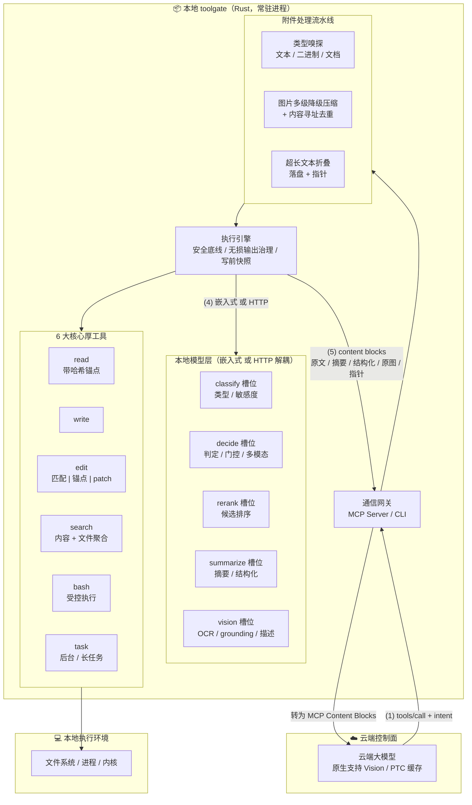
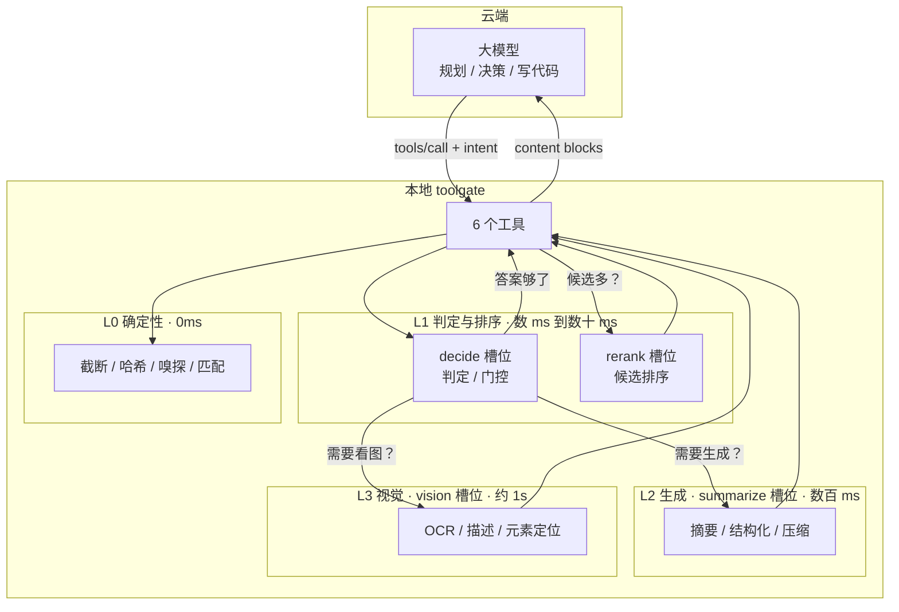

# toolgate 架构设计

> 围绕本地小模型构建的工具层。云端做规划，本地做理解与执行。

**版本 v2**。核心决策：围绕本地小模型构建工具——工具不是「执行器」，
而是「执行 + 理解 + 协商」的三层结构，理解层由本地 SLM 承担。v1 的差异
记录见附件 E.6 与附录 A。

**文档规则**：本目录正文只写**决策**（做什么、不做什么、约束与失败模式）；
参考、比较、研究、实测与背景记录统一放 [95-references.md](architecture/95-references.md)
（附件 E）。仓库根 [AGENTS.md](../AGENTS.md) 是架构迭代与实现的工作规范
（红线、流程、验证），动手前先读。

本目录是唯一权威描述。当前代码实现 v1 骨架（无 SLM），差距见 §13。

---


## 阅读地图

本文件是总目录与核心命题（§0–§2）；其余章节按主题分册，章节编号保持一致。

> 路径基准：下表链接相对本文件所在的 `docs/` 目录。在文件预览器中若链接不可点击，分册文件直接位于 `docs/architecture/`（例如 `docs/architecture/03-slots.md`）。

| 分册 | 章节 | 内容 | 什么时候读 |
|---|---|---|---|
| [03-slots.md](architecture/03-slots.md) | §3 | 五个能力槽位与替换判据 | 要接模型、换模型时 |
| [04-tools.md](architecture/04-tools.md) | §4–§5 | 三层结构、intent、六个工具 | 要实现或改工具时 |
| [06-cost.md](architecture/06-cost.md) | §6–§7 | 成本模型、介入判据 | 要定成本与阈值时 |
| [08-isolation.md](architecture/08-isolation.md) | §8 | 数据隔离：四档、规则、回退 | 要定隔离策略时 |
| [09-output.md](architecture/09-output.md) | §9–§10 | 输出治理、附件与多模态 | 要处理输出与图片时 |
| [11-runtime.md](architecture/11-runtime.md) | §11–§14 | 边界、前提修正、差距、路线图 | 排期与范围判断时 |
| [15-risk.md](architecture/15-risk.md) | §15–§17 | 风险、缓存、安全 | 评估风险与安全时 |
| [18-deployment.md](architecture/18-deployment.md) | §18–§19 | 部署形态、接口契约、技术选型 | 部署与选型时 |
| [20-behavior.md](architecture/20-behavior.md) | §20–§22 | 快照、编排（含本地 agent 形态）、主动性 | 实现运行行为时 |
| [90-appendices.md](architecture/90-appendices.md) | 附录 A–D | 对照表、术语表、配置参考 | 查表时 |
| [95-references.md](architecture/95-references.md) | 附件 E | 参考、比较、研究与实测数据 | 查依据与背景时 |

**唯一权威**：本目录（architecture.md + architecture/ 分册）是同一份可执行架构的完整描述；分册不是副本，是章节的物理拆分。任何冲突以本文件的总目录编号为准。

## 0. 一句话说清它是什么

toolgate 是一个**本地常驻的工具层**，向 agent 暴露 6 个工具。
与普通工具层的区别：每个工具内部都有一条**本地小模型理解链路**，在结果离开
本地之前先做理解与压缩。

它服务三种形态（§6.2）：直连云端 agent（F1）、PTC 云端 agent（F2）、本地
agent（F3）。三者的「理解与压缩」值什么不一样——F1 省 token，F2 省「程序
自己解析」，F3 省不了 token（本地看本地结果），它的价值在隔离与治理。

它要回答的问题不是「怎么执行」，而是：

> **哪些东西根本不需要上传？**

---

## 1. 核心命题

三条，每条可被证伪。

### 1.1 命题一：理解应该发生在数据离开本地之前

云端模型按 token 计费，本地模型按「输入 token 的 prefill 时间 + 固定开销 + 生成时间」
计费（本机 prefill 实测与口径见 §6.4）。一份 5000 行的失败日志：

| 路径 | 云端 token | 延迟 | 成本（按 $3/Mtok） |
|---|---|---|---|
| 原样上传 | 约 50,000 | 0 | $0.15 |
| d1 判错 + LFM3 摘要 | 约 400 | +0.6s（未含 prefill，见 §6.4） | $0.0012 |

差 125 倍。这是 F1 单场景的账；三形态（F1/F2/F3）的完整账见 §6.2。而「这次构建失败了，3 个测试超时，涉及 test_a/test_b/test_c」
这个信息量，对下一步决策已经足够。

**推论**：压缩的落点必须在本地。等数据到了云端再压缩，token 已经花掉了。

### 1.2 命题二：分工的判据是「答案空间」，不是「模型大小」

**分工判据是「答案空间大小」，不是模型大小，也不引用具体模型的免责声明。**
模型一换论证就失效，而且与 §3「架构不绑定具体模型」矛盾。

真正的判据是**答案空间大小**（§2.1 展开）：

| 要的答案 | 谁做 | 为什么 |
|---|---|---|
| 是/否、几选一、一个分数、一段坐标 | 本地 | 答案空间小，一次前向就够 |
| 一段摘要、一份结构化 JSON | 本地 | 答案空间是一段话，不需要推理 |
| 一个方案：长程规划、跨文件推理、多轮错误恢复 | 云端 | 答案空间大，本地付不起 |

本地模型最稳的还是这些：判断一段输出有没有错、判断这张图是截图还是照片、
从日志里抽出错误类型、给候选排序、把 5000 行压成 20 行。它们的共同点是
**答案空间小、判据明确、错了代价低**——这正是小模型的甜区，也是云端大模型
杀鸡用牛刀的地方。

**判据不会因为模型变强而失效，只会因为模型变强而移动边界。**

2026 年的事实值得记下来，因为它已经推翻了「本地只能做分类」这个印象：

- 开源权重模型在工具调用基准上进入与云端前沿同一档：据公开榜单，BFCL v3
  上 GLM-4.5 为 76.7%、Qwen3 32B 为 75.7%，与前沿的差距是几个百分点而非
  数量级；τ-bench 的差距仍在，但已不是「不能用」。
- 30B 级模型能在一张消费级显卡上跑到可用速度：Muse Glimmer 30B 在 RTX 3090
  上约 127 tokens/s，足以跑本地 agent 循环。
- 端侧 2B 级也有 agentic 能力：MiniCPM5-2B 的 Agentic Index 在同规模里靠前。

**但长程仍然分得开——分开的原因不是步数**。本地跑 20 步不是问题，问题是
错误会累积：每步 95% 正确，20 步下来只剩 36%。真正决定能不能跑长的是
「错了能不能立刻发现」：有测试、能编译、有 diff 可看，错了当场知道，累积
不起来；没有验证手段，3 步就可能跑到沟里。

所以命题二的准确表述是：

> 云端定目标与验收标准，本地执行并逐步验证。
> 判据有两条：**单步决策的答案空间**（这一步该谁做）、
> **每步能否验证**（本地能连续跑多久）。
> 模型变强只把这两条线往右推，不改变线的存在。

**「步数」不是判据，「可验证性」才是。** 这一条解释了为什么「本地执行」是可行的
——不是本地模型突然变聪明了，是它执行的每一步都能被外部反馈纠正。

**这对架构的影响是具体的**：本地模型变强时槽位职责扩大（§3.9），而「谁负责
编排」会翻转——见 §21.7。

### 1.3 命题三：工具的价值取决于「它挡住了多少不该上传的东西」

按这个标准重新看 6 个工具：

| 工具 | 主要浪费 | 本地能挡住什么 |
|---|---|---|
| bash | 日志动辄几万行 | 抽出错误摘要，原日志落盘 |
| search | 命中几百条 | rerank 后只给 top-k |
| read | 整文件读进来只为找一段 | 结构化提取，只给相关段 |
| read（图片） | 一张截图几 MB | OCR/描述后只给文字 |
| task | 长任务输出累积 | 状态判断 + 增量摘要 |
| write/edit | 几乎不浪费 | —— |

write/edit 是唯二「挡不住什么」的工具，它们的存在是为了让前四个有输出对象。

**这张表是 F1 形态的账**（§6.2）：结果进云端上下文时，「浪费」就是 token。
F2/F3 下「浪费」换了定义——变成「数据暴露面」与「程序解析成本」，所以
同一张表在那些形态下要重读（§21.5、§21.7）。

### 1.4 设计原则：一次做对优于试错纠正

每次「请求 → 不满意 → 再请求」的往返，成本不是一次调用那么简单：

1. 一次额外的模型调用（云端 token + 延迟）；
2. 上下文里多一条消息——**之后每一轮都占着**；
3. **模型可能基于不完整信息做决策**，然后在不该确定的地方确定。

第三点最贵，而且往往不可见：模型拿着半截信息给出了结论，没人发现。

所以设计时优先问：**能不能让第一次调用就给对？**

#### 1.4.1 三类摩擦

| 类型 | 表现 | 对策 |
|---|---|---|
| 选择负担 | 模型要在多个模式里选，选错要重来 | 让参数形态隐含模式；能自动判就不要暴露成选项 |
| 信息不足 | 给少了，模型得再要一次 | 不确定时两种都给；超限时附结构摘要 |
| 表达受限 | 想做的事工具不支持，只能绕 | 支持更完整的表达（如管道与重定向） |

#### 1.4.2 判据：不确定时该多给还是少给

这取决于**哪种错误的后果更难恢复**：

| 场景 | 多给的代价 | 少给的代价 | 选择 |
|---|---|---|---|
| 图片：结构化 vs 原图 | 多约 1200 token | 可能再来一轮（约 1500 token + 一次判断风险） | 概率落在中间时**都给** |
| 文本：摘要 vs 原文 | 大量 token | 模型可能判断错 | 给摘要 + 精确指针 |
| 能力：给不给 image block | 客户端硬失败中断整轮 | 多一轮 | **少给** |

前两行「多给」赢，第三行「少给」赢。区别在于失败是否可恢复：
token 花多了可以接受，客户端报错中断要重来。

#### 1.4.3 已识别但未消除的摩擦

诚实记录，避免假装架构已经最优：

| 摩擦 | 为什么还在 |
|---|---|
| 隔离回退后模型可能不满意 | 工具层不能提供「放宽隔离」的接口（§8.8），这是硬约束 |
| 大文件仍要多次 read | offset 续读是唯一可靠的定位方式，一次给全会撑爆上下文 |
| edit 因内容真的变了而失败 | 内容变了说明本地状态与模型认知不一致，重新 read 是必要的。**格式差异不属于这一类**——空白、行尾、缩进由四级匹配在本地消化（§5.4） |

这三处不是设计缺陷，是「消除摩擦」与「其他约束」的权衡结果。

#### 1.4.4 子原则：失败要可行动

工具无法完成请求时，返回三段而不是一句错误：

1. **事实**——我看到了什么（已知信息）
2. **原因**——为什么给不了你要的
3. **选项**——你可以怎么办

反例与正例：

| 写法 | 模型能做什么 |
|---|---|
| 「不支持此操作」 | 只能猜，或反复重试 |
| 「ERROR: vision unavailable」 | 同上 |
| 元信息 + 路径 + 解锁方式 | 可以决定换方式、或告诉用户补配置 |

本架构里的三处实例：

| 场景 | 给的三段 |
|---|---|
| read 拿不到图片内容（§10.1） | 格式/尺寸/大小/路径 + 为什么没有内容 + 三条可选路径 |
| edit 定位失败（§5.4） | 原文片段 + d1 归因（上下文不足/文件已变/格式差异）+ 建议 |
| 隔离回退（§8.7） | 请求档位 + 实际动作 + 命中规则 + 为什么不用更高一级 |

**判据**：如果模型拿到这个返回后，下一步只能「猜」或「重试同样的调用」，
说明失败不可行动，设计有问题。

#### 1.4.5 怎么保证每个错误都可行动

光有原则不够——实现时很容易顺手写一句 「工具执行失败」就返回。
所以要三层保证，让「不可行动的错误」写不出来或测不过。

**第一层：类型层**

ToolError 的每个变体都必须携带可执行的下一步，并且带一个稳定的 errorCode——程序用它分支，模型读 fact/reason/next_steps：

```rust
pub enum ToolError {
    UnknownTool { name: String, available: Vec<String> },
    BadArgument { code: ErrorCode, message: String, next_steps: Vec<String> },
    Io { code: ErrorCode, fact: String, reason: String, next_steps: Vec<String> },
    Failed { code: ErrorCode, fact: String, reason: String, next_steps: Vec<String> },
}

pub enum ErrorCode {
    PathNotFound, EncodingInvalid, AnchorMismatch, EditAmbiguous,
    Timeout, OutputLimit, SlotUnavailable, IsolationRefused,
}
```

`errorCode` 是稳定契约，客户端可以按它分支；`fact/reason/next_steps` 是给模型读的三段。BadArgument 也要有 next_steps——「缺少参数」的下一步是「补哪个参数」，不是一句错误。

**第二层：返回层**

错误响应在 structuredContent.error 里结构化，而不是只有一段文本：

```json
{
  "isError": true,
  "content": [{ "type": "text", "text": "..." }],
  "structuredContent": {
    "error": {
      "code": "ENCODING_INVALID",
      "fact": "文件不是合法 UTF-8，第 42 字节无法解码",
      "reason": "读-改-写要求字节保真，lossy 写回会破坏原字节",
      "nextSteps": [
        "用 bash 转码后编辑：iconv -f GBK -t UTF-8 原文件 > /tmp/x",
        "或改用 read 查看可读部分"
      ]
    }
  }
}
```

文本形态给模型读，结构化形态给程序判断。

**第三层：测试层**

遍历所有错误路径，断言 nextSteps 非空：

```rust
#[test]
fn every_error_carries_next_steps() {
    // 逐个触发：文件不存在、编码非法、锚点失配、参数缺失、
    // 未知工具、超时、输出超限……
    for resp in all_error_paths() {
        let steps = resp.meta["error"]["nextSteps"].as_array().unwrap();
        assert!(!steps.is_empty(), "错误缺少可执行下一步：{resp:?}");
    }
}
```

**元测试**：用 match 穷举所有 ToolError 与 ErrorCode 变体，**不要加 `_` 通配分支**——本 crate 的枚举 match 非穷举本身就是编译错误（E0004），新增变体会直接编译失败。`#![deny(non_exhaustive_omitted_patterns)]` 只用于跨 crate 的 `#[non_exhaustive]` 枚举；本项目的变体都在本 crate 内，不需要它：

```rust
fn assert_all_variants_covered(e: &ToolError) {
    match e {
        ToolError::UnknownTool { .. } => {}
        ToolError::BadArgument { .. } => {}
        ToolError::Io { .. } => {}
        ToolError::Failed { .. } => {}
        // 新增变体 → 非穷举编译失败 → 逼着补测试
    }
}
```

这条比前两层更重要：**前两层靠自觉，第三层靠编译器**。

### 1.5 设计原则：最少依赖

**默认构建只包含「跑起来所必需」的依赖；每个依赖必须证明自己不可替代。**

依赖不是免费的：每个依赖都带来升级成本、许可证审查、编译时间与供应链风险。
「最少」不是零依赖，而是把依赖当负债管理——标准库能写的不引 crate，现有依赖
能做的不新增，能做成可选的绝不放进默认构建。

依赖分三层，准入规则不同：

| 层 | 定义 | 准入规则 |
|---|---|---|
| 默认层 | `cargo build --release` 必须编入 | 只允许六类：协议编解码、异步运行时、错误与日志、哈希与编码、文本处理、媒体解码；逐项登记于 §19.6 |
| 可选层 | Cargo feature 或运行时配置开启，默认构建不含 | 默认关闭；开启后独立编译、独立测试；不得改变默认层的行为 |
| 禁止层 | 不进入任何构建 | agent 框架（ADR 0001）、数据库 / ORM、Web 框架、模板引擎、GC 运行时、日志聚合客户端 |

**准入四问**（新依赖逐条回答，答不上就不引入）：

1. **标准库能否完成？** 能 → 自己写，不引入依赖。
2. **现有依赖能否完成？** 能 → 复用，不新增。
3. **它会进默认层吗？** 会 → 说明为什么不能做成可选层，并登记传递依赖规模（实测见附件 E.8）。
4. **它会破坏纯 L0 版的单二进制吗？** 带 C/C++ 绑定、动态库、平台框架的只能进可选层（§19.3）。

**这条原则已经体现在三处既有决策里**：不基于任何 agent 框架（ADR 0001）、
槽位全空仍可用（§3.8）、纯 L0 版单二进制分发（§19.3）。§19.6 是它的技术选型台账。

**「核心能力」与「默认依赖」是两回事**：本地模型是 v2 的核心（§1.1–§1.3），
但默认构建不编入模型后端——槽位全空的部署是完整可用的产品（§3.8），带模型的
发行版是打开可选层，不是另一套代码。

---

## 2. 系统全景

### 2.0 组件视图

这张图保留原始架构图的全部组件，只在其上增加「本地模型层」。



### 2.1 成本阶梯视图

同一套组件，按「答案空间大小」重排成四级阶梯。这张图回答的是
「一次调用该走到哪一层」。



分工的判据是**答案空间大小**：

- 答案空间小（是/否、几选一、一段坐标）→ 本地 d1，5.7ms
- 答案空间是「一段话」但不需要推理 → 本地 LFM3，数百 ms
- 答案空间是「需要理解图片」→ 本地 VL，约 1s
- 答案空间是「长程规划、写代码、跨文件推理」→ 云端

多步编排不在这张表里，因为它可以留在本地（§21.7）。判据不是步数，是
**每步能否验证**：能跑测试、能编译、能看 diff，本地就跑得长；没有验证手段，
每一步都在赌，跑三步就危险。

**云端给目标与验收标准，本地执行。** 这不是口号，它决定了两边的输入输出：
云端拿到「目标 + 验收标准」，本地拿到「一个具体操作 + 当前状态」。所以本地
永远不需要知道「为什么要改」，只需要知道「改哪里、改成什么、怎么确认改对了」。

这条判据比「大模型 vs 小模型」清晰，因为它能直接落到实现：
每个工具在调用本地模型前，先问自己「我要的答案是什么形状」。

### 2.2 1+1>2 具体乘在哪

「1+1>2」成立的前提是**两者做不同的事**：

| | 云端大模型 | 本地小模型 |
|---|---|---|
| 擅长 | 长程规划、跨文件推理、写代码 | 单点判定、局部理解、压缩 |
| 不擅长 | 处理长原始输出（贵） | 无验证手段的长程推理（会崩；有验证就能跑长，见 §1.2） |
| 单位成本 | 按 token 计，高 | 按毫秒计，低 |
| 错误模式 | 慢而准 | 快而局部 |

乘法效应出现在**交接点**：云端不需要看原始数据，只需要看「理解后的形状」；
本地不需要做决策，只需要回答「这段东西是什么」。

举个具体的：云端说「修一下这个测试」。本地 bash 跑出 4000 行失败日志，
d1 判定「3 个测试超时，都在 async 相关」，LFM3 摘要成 20 行。云端拿到
这 20 行，直接定位到 async runtime 配置。

如果没有本地这一层，云端要读 4000 行（贵且分散注意力）；如果没有云端
这一层，本地不知道「该修什么」。**缺任一半，这件事都做不成**——这才是
1+1>2 的确切含义，不是「两个模型都用上」。

**这个例子是 F1 形态**（§6.2）。F2（PTC）下云端看不到中间结果，交接点变成
「程序与工具之间」；F3（本地 agent）下云端只给目标，交接点在「云端与本地
agent 之间」。乘法效应仍在，但乘的位置变了。

**云端最不可替代的不是「知识更多」，而是「能生成针对当前任务的程序」**：一个
脚本、一次批量迁移、一段正则。这些是任务专属的、一次性的，本地小模型做不出来
——它的能力是固定的。而本地最不可替代的是「不用把原始数据交出去」。两者交换的
不是算力，是「通用性」与「数据位置」。

---
