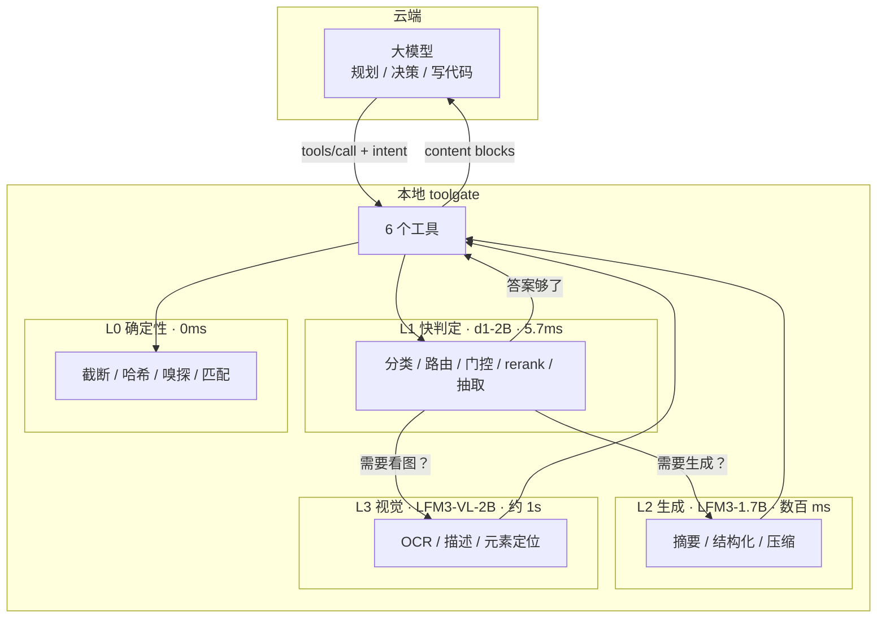

# toolgate 架构设计

> 围绕本地小模型构建的工具层。云端做规划，本地做理解与执行。

**版本 v2**。v1 把本地小模型当作可选增强并移出了工具层，这是判错的：
本架构的核心恰恰是**围绕本地小模型构建工具**——工具不是「执行器」，
而是「执行 + 理解 + 协商」的三层结构，理解层由本地 SLM 承担。

本文档是可执行架构的唯一权威描述。当前代码实现的是 v1 骨架（无 SLM），
与本文档的差距见 §12。

---

## 0. 一句话说清它是什么

toolgate 是一个**本地常驻的工具层**，向云端 agent 暴露 6 个工具。
与普通工具层的区别：每个工具内部都有一条**本地小模型理解链路**，
在结果回到云端之前先做理解与压缩。

它要回答的问题不是「怎么执行」，而是：

> **哪些东西根本不需要上传？**

---

## 1. 核心命题

三条，每条可被证伪。

### 命题一：理解应该发生在数据离开本地之前

云端模型按 token 计费，本地模型按毫秒计费。一份 5000 行的失败日志：

| 路径 | 云端 token | 延迟 | 成本（按 $3/Mtok） |
|---|---|---|---|
| 原样上传 | 约 50,000 | 0 | $0.15 |
| d1 判错 + LFM3 摘要 | 约 400 | +0.6s | $0.0012 |

差 125 倍。而「这次构建失败了，3 个测试超时，涉及 test_a/test_b/test_c」
这个信息量，对下一步决策已经足够。

**推论**：压缩的落点必须在本地。等数据到了云端再压缩，token 已经花掉了。

### 命题二：本地小模型的价值不在「替代云端」，而在「筛选」

LFM3-1.7B 官方文档明确写着：不推荐用于 agentic coding 或复杂多步推理
（"not recommended for agentic coding or complex multi-step reasoning
due to its small size"）。

所以它不做云端做的事。它做云端做起来**贵且没必要**的事：

- 判断一段输出有没有错（分类）
- 判断这张图是 UI 截图还是文档照片（分类）
- 从日志里抽出错误类型与关键行（抽取）
- 给检索候选排序（rerank）
- 把 5000 行压成 20 行（摘要）

这些任务的共同点：**答案空间小、判据明确、错了代价低**。这正是 2B 模型
的甜区，也正是云端大模型杀鸡用牛刀的地方。

### 命题三：工具的价值取决于「它挡住了多少不该上传的东西」

按这个标准重新看 6 个工具：

| 工具 | 主要浪费 | 本地能挡住什么 |
|---|---|---|
| bash | 日志动辄几万行 | 抽出错误摘要，原日志落盘 |
| search | 命中几百条 | rerank 后只给 top-k |
| read | 整文件读进来只为找一段 | 结构化提取，只给相关段 |
| read（图片） | 一张截图几 MB | OCR/描述后只给文字 |
| task | 长任务输出累积 | 状态判断 + 增量摘要 |
| write/edit | 几乎不浪费 | —— |

write/edit 是唯二「挡不住什么」的工具，它们的存在是为了让前四个有输出对象。

---

## 2. 分工模型



分工的判据是**答案空间大小**：

- 答案空间小（是/否、几选一、一段坐标）→ 本地 d1，5.7ms
- 答案空间是「一段话」但不需要推理 → 本地 LFM3，数百 ms
- 答案空间是「需要理解图片」→ 本地 VL，约 1s
- 答案空间是「需要规划、写代码、多步推理」→ 云端

这条判据比「大模型 vs 小模型」清晰，因为它能直接落到实现：
每个工具在调用本地模型前，先问自己「我要的答案是什么形状」。

---

## 3. 三级本地模型的能力边界

以下是官方规格，不是推测。

### d1-2B（决策模型）

| 项 | 值 |
|---|---|
| 参数 | 1.92B |
| 基座 | LFM3-VL-2B |
| 上下文 | 128K |
| 输入 | 一个 state（文本或 JSON）+ 图片/视频 + 任意数量命名问题 |
| 输出 | **带概率的类型化答案，不生成 token** |
| 延迟 | H100 5.7ms / MI325X 3.8ms 每决策 |
| 语言 | 17 种含中文 |
| 官方定位 | 路由与分诊、审核与护栏、意图分类、文档抽取、判定与 rerank、视觉检查 |

三个特性直接决定架构：

1. **不生成 token** —— 输出是受限的，所以不会跑偏，也不需要解析文本。
2. **一次调用可问任意数量问题** —— 一个 state 上可以同时问「有错吗」
   「什么类型」「严重吗」，一次前向传播出全部答案。
3. **带概率** —— 可以做置信度门控：低置信转云端，不硬答。

### LFM3-1.7B（文本生成）

| 项 | 值 |
|---|---|
| 参数 | 1.73B |
| 上下文 | 256K |
| 语言 | 17 种含中文 |
| 官方定位 | 本地 agent、工具调用、结构化输出、领域微调 |
| **明确不适用** | agentic coding、复杂多步推理 |

「不适用」这条要写进设计里：**不要让 LFM3 写代码或做规划**。
它做的是「把长东西变短、把乱东西变结构化」。

### LFM3-VL-2B（视觉）

| 项 | 值 |
|---|---|
| 参数 | 1.92B |
| 输入 | 文本 + 图像 + 视频，支持多图 |
| 能力 | OCR、布局标注、pointing、grounding、视觉引导工具调用 |

**grounding 是这里最有价值的能力**：它能把「登录按钮」映射到图片里的
具体坐标。这让「看截图改 UI」这件事不必上传原图——上传坐标就够。

---

## 4. 三层结构与 intent 契约

### 4.1 每个工具的三层

```text
执行层   → 真正做操作：读文件、跑命令、检索
理解层   → 本地 SLM 介入：判定、摘要、抽取、看图
协商层   → 决定回传什么：原文 / 摘要 / 结构化 / 原图 / 指针
```

协商层是新概念，也是本架构与普通工具层的分水岭。它决定「云端看到什么」。

### 4.2 intent：把协商权交给调用方

每个工具新增可选参数 intent，取值：

| intent | 含义 | 典型场景 |
|---|---|---|
| raw | 要原文，不要加工 | 改代码前读文件 |
| summary | 要摘要，省 token | 了解构建为什么失败 |
| structured | 要结构化数据 | 程序化处理检索结果 |
| visual | 要原图 | 需要精确视觉推理 |
| auto（默认） | 由 d1 判定 | 大多数情况 |

设计要点：**默认 auto，但 auto 不是「总是摘要」**。d1 的判定规则见 §8。

### 4.3 协商结果必须可预测

云端要能预期「我说 raw 会拿到什么」。所以协商层的行为是确定的：

- intent=raw 且内容未超限 → 一定返回原文，不做任何加工
- intent=summary → 一定返回摘要 + 原始指针
- intent=structured → 一定返回 JSON，schema 在工具描述里写明

这条是缓存友好性的要求：行为不可预测的工具有效地等于缓存不可用。

---

## 5. 各工具的智能路径

每个工具写清楚：L0 做什么、本地模型在哪一步介入、协商层给什么。
**不是所有工具都需要全部三级**——不需要的就不写，这是「不越需求」。

### 5.1 bash —— 收益最大的一个

```text
L0 执行 → 拿 stdout/stderr
L0 双阈值截断（2000 行 / 50KB）+ 完整输出落盘
L1 d1 判定（一次前向，多个问题）：
     has_error?          概率
     error_kind?         编译 / 测试 / 权限 / 网络 / 资源 / 未知
     severity?           阻断 / 警告 / 噪音
     needs_full_context? 是/否
L2 LFM3 摘要（仅当 d1 判定 has_error 且 severity=阻断）：
     失败根因 + 涉及的文件与测试 + 建议排查方向
L0 协商：
     raw        → 截断后的原文 + 落盘指针
     summary    → d1 判定 + LFM3 摘要 + 落盘指针
     structured → JSON：{exitCode, errorKind, severity, failedItems[], spillPath}
     auto       → 输出 < 500 token 给原文；否则走 summary
```

为什么 bash 收益最大：一次失败的测试套件输出常在 3000-8000 行，
其中真正有信息量的是最后 50 行加上中间散落的断言失败。人看也是这么看的。

**d1 的四个问题一次问完**，这是它「任意数量命名问题」特性的直接用法。

### 5.2 search —— rerank 是 d1 的官方用途

```text
L0 检索（正则 / 通配符），拿全部命中
L0 若命中数 ≤ 20，直接返回（没必要 rerank）
L1 d1 rerank（仅当命中数 > 20）：
     对候选按「与 query 意图的相关性」打分，返回 top-k 的顺序
L0 协商：按 intent 返回全部 / top-k / 结构化列表
```

设计要点：**只在候选多时才 rerank**。20 条以内的命中，rerank 的延迟
反而超过收益。

### 5.3 read —— 文本与图片两条路

**文本路径**

```text
L0 读文件、嗅探类型、截断
L1 d1 判定：
     file_kind?   代码 / 配置 / 日志 / 文档 / 数据
     sensitivity? 含密钥 / 含个人信息 / 普通
     best_view?   全文 / 结构 / 片段
L2 LFM3 结构化（仅当 intent=structured 或 auto 且 best_view=结构）：
     代码 → 函数签名列表、TODO、导入
     配置 → 键值树
     日志 → 错误行与时间线
协商：raw 给原文；structured 给提取结果 + 行号范围
```

**图片路径**

```text
L0 嗅探 MIME、解码
L1 d1 判定：
     image_kind?  UI 截图 / 文档照片 / 图表 / 照片 / 代码截图
     has_text?    是/否
     need_pixels? 是/否（判断是否必须原图）
L2/L3 按 image_kind 分流：
     UI 截图  → VL 做 grounding，返回元素列表 + 坐标
     文档照片 → VL 做 OCR，返回文字 + 布局
     图表     → VL 描述趋势 + 关键数值
     代码截图 → VL 做 OCR，返回代码文本
协商：
     visual     → 压缩后的原图（走 v1 的压缩流水线）
     structured → 元素列表 / OCR 文本 / 描述
     auto       → need_pixels 为真给原图，否则给结构化结果
```

**这一条是本架构最有价值的设计**：一张 UI 截图 800KB，base64 后约 1.1MB，
约 1500 token（视觉 token 另算）。而 VL 的 grounding 结果可能是
「登录按钮 (120,340,86,32)、用户名输入框 (40,200,320,40)…」约 300 token。

对「帮我改这个页面的按钮颜色」这类任务，坐标比原图更有用——它直接告诉
云端该改哪一行 CSS。

### 5.4 edit —— 用 d1 解释失败

```text
L0 精确匹配 → 命中唯一则替换
L0 未命中 → 归一化匹配（引号 / 破折号 / 空白）
L1 d1 判定（仅当两种匹配都失败）：
     failure_kind?  上下文不足 / 文件已变 / 格式差异 / 根本不存在
     suggestion?    扩大上下文 / 重新 read / 忽略空白 / 确认路径
L0 返回：错误 + d1 的失败归因 + 建议
```

edit 本身不产生浪费，但**失败很贵**——一次失败意味着云端要重新 read
（几千 token）再重试。d1 用 5.7ms 把「为什么失败」说清楚，能省掉这轮往返。

### 5.5 task —— 状态判断 + 增量摘要

```text
L0 启动 / 读累积输出 / 终止
L1 d1 判定：
     state?      运行中 / 已完成 / 卡住 / 已崩溃
     progress?   有进展 / 无变化 / 报错循环
L2 LFM3 增量摘要（仅当 action=read 且累积输出 > 2000 token）
协商：原始增量 / 摘要 + 状态
```

「卡住」的判定值得单说：开发服务器启动后输出不再变化，可能是正常等待，
也可能是死锁。d1 看最后几行 + 时间间隔能给出概率判断。

---

## 6. 成本与延迟模型

### 6.1 单次调用的成本阶梯

| 层 | 模型 | 延迟 | 何时触发 |
|---|---|---|---|
| L0 | 无 | <1ms | 永远 |
| L1 | d1-2B | 5.7ms（GPU）/ 数十 ms（CPU/MLX） | 需要判定时 |
| L2 | LFM3-1.7B | 数百 ms | 需要生成文本时 |
| L3 | LFM3-VL-2B | 约 1s | 需要看图时 |
| L4 | 云端 | 秒级 + token 费 | 需要规划/编码时 |

**关键：L1 便宜到可以每个工具调用都跑。** 5.7ms 相对于一次 MCP 往返
（通常几十到几百 ms）可以忽略。所以 d1 应该默认开启，而不是可选。

L2 的数百 ms 就要算账了：只有当「省下的 token 值这几百 ms」时才该触发。

### 6.2 三个真实场景的账

**场景 A：构建失败**

| | 原样上传 | 走本架构 |
|---|---|---|
| 输出规模 | 4200 行 / 约 42K token | 摘要 380 token + 指针 |
| 延迟 | 0 | +620ms（d1 + LFM3） |
| 云端成本 | $0.126 | $0.0011 |
| 净效果 | | 省 114 倍成本，代价 0.6s |

**场景 B：UI 截图分析**

| | 原样上传 | 走本架构 |
|---|---|---|
| 输入 | 800KB PNG，压缩后约 1200 token（+视觉 token） | grounding 结果约 300 token |
| 延迟 | 0 | +1.1s |
| 信息损失 | 无 | 视觉风格细节丢失，坐标保留 |
| 适用 | 需要「这页面好看吗」 | 需要「改哪个元素」 |

**注意场景 B 是有损失的**：判断审美必须看原图。所以 intent 里保留 visual。

**场景 C：小输出（200 行的 ls）**

| | 原样上传 | 走本架构 |
|---|---|---|
| 规模 | 200 行 / 2K token | 若强制摘要：400 token |
| 延迟 | 0 | +600ms |
| 结论 | **不该走本地模型** | 延迟换来的节省不值 |

场景 C 说明了为什么需要 §7 的介入判据。

### 6.3 本地模型的硬件前提

| 部署 | d1 延迟 | LFM3 延迟 | 可行性 |
|---|---|---|---|
| NVIDIA H100 | 5.7ms | 数百 ms | 理想 |
| Apple Silicon（MLX） | 数十 ms | 约 1s | 可用 |
| CPU only | 数百 ms | 数秒 | 仅 d1 勉强可用 |

这决定了「默认开启 d1」的判据：**CPU 环境下 d1 也要门控**，
否则每次工具调用多几百 ms 会拖垮体验。

---

## 7. 介入判据：什么时候不用本地模型

这一节是防止架构变成「什么都过一遍模型」的刹车。

### 7.1 硬性不介入

| 条件 | 理由 |
|---|---|
| intent=raw | 调用方明确要原文，加工即违背契约 |
| 输出 < 500 token | 摘要的延迟成本 > token 节省 |
| 需要精确计数/格式 | SLM 会数错，用确定性代码 |
| 修改代码前的读取 | 改代码必须看原文 |

### 7.2 置信度门控

d1 输出带概率，所以有明确的门控规则：

```text
p ≥ 0.85          → 采用本地判定
0.60 ≤ p < 0.85   → 采用，但在返回里标注低置信
p < 0.60          → 不采用本地判定，走原始路径或转云端
```

这条比「小模型可信吗」的争论有用：**它把不确定性变成了可执行的分支**。

### 7.3 降级路径

本地模型不可用时（未安装、显存不足、推理失败），工具必须仍然工作：

- L1 不可用 → 跳过判定，走 L0 原始路径
- L2 不可用 → 跳过摘要，给原文 + 指针
- L3 不可用 → 图片走 v1 的压缩流水线，原图直传

**降级必须是静默的**：不因为本地模型挂了就让工具报错。降级后在 meta 里
标注 slm 不可用，供调用方判断。

---

## 8. 数据隔离

这是本架构最容易被低估的收益。原设计文档列了「数据隔离」但没说清它
怎么实现——实际上，**它完全依赖本地小模型**。

### 8.1 三种隔离强度

| 级别 | 含义 | 实现 |
|---|---|---|
| 不隔离 | 原始内容全部上传 | 无（v1 的做法） |
| 摘要隔离 | 只上传摘要，原文留本地 | L2 LFM3 |
| 理解隔离 | 连摘要都不上传，只上传判定结果 | L1 d1 |

理解隔离是最强的一档，也是 d1 独有的价值：**它不生成文本，所以不存在
「摘要里意外带出敏感信息」的可能**。它只回答「这段内容属于哪一类」。

### 8.2 各工具能提供的隔离

| 工具 | 可做到的最强隔离 | 丢失什么 |
|---|---|---|
| bash | 理解隔离（只说「有 3 个测试失败，类型是超时」） | 具体断言内容 |
| search | 理解隔离（只说「命中集中在 auth 模块」） | 具体行 |
| read（文本） | 摘要隔离 | 原文细节 |
| read（图片） | 理解隔离（只说「是登录页截图，含 2 个输入框」） | 像素 |
| write/edit | 不适用（本来就是写） | —— |

### 8.3 但隔离不是默认

**默认必须是 auto，而 auto 的判定偏向「够用就好」，不是「最严格」**。

理由：过度隔离会让云端瞎猜，产生更多往返，反而更贵。隔离强度应该由
调用方按场景选：

- 处理生产日志、含用户数据的截图 → 显式要求 summary 或更严格的档位
- 日常开发 → auto 即可

这条写进文档是为了防止一种常见误读：以为这个架构是「隐私优先」的。
它是「成本优先，顺带能隔离」，隔离强度可调。

---

## 9. 输出治理：两层

v1 只有确定性截断。v2 增加本地模型这一层，两者分工明确。

### 9.1 第一层：确定性（永远执行）

| 动作 | 阈值 | 落点 |
|---|---|---|
| 双阈值截断 | 2000 行 / 50KB | 内存 |
| 完整输出落盘 | 触发截断时 | 系统临时目录，内容寻址 |
| 图片压缩 | 1568px / 1.2MB base64 | 内存 |

这一层**不看内容语义**，只看体积。它的价值是「保证任何情况下都不会
把 50MB 的东西塞进上下文」。

### 9.2 第二层：语义（按判据触发）

| 动作 | 触发条件 | 模型 |
|---|---|---|
| 错误判定 | bash/task 输出 > 500 token | d1 |
| rerank | search 命中 > 20 | d1 |
| 摘要 | d1 判定有错且阻断 | LFM3 |
| 结构化提取 | intent=structured | LFM3 |
| 图像理解 | read 读到图片且非 visual | VL |

这一层**看内容语义**，判断「这段东西值不值得全部上传」。

### 9.3 两层的顺序不能颠倒

必须**先确定性、后语义**。理由：

- 先语义后确定性，意味着可能把 50MB 喂给 2B 模型——直接爆显存
- 先确定性后语义，模型看到的是已经裁到 50KB 的内容，安全

但这里有个矛盾：**语义层需要看完整内容才能判准**（比如错误可能在第
3000 行，而截断保留了尾部——恰好能覆盖；但如果是搜索类的，头部更相关）。

解法：**落盘之后再让模型看落盘文件**。LFM3 有 256K 上下文，能一次读完
一份 50KB 的日志。所以顺序是：

```text
执行 → 截断（保尾部）+ 落盘 → 模型读落盘文件 → 摘要 → 返回摘要 + 指针
```

不是「模型看截断后的部分」，而是「模型看完整落盘文件」。这是关键细节，
否则摘要会漏掉中间的错误。

---

## 10. 附件与多模态

v1 的做法（纯压缩）保留为降级路径。v2 的主路径是本地理解。

### 10.1 图片处理决策树

```text
读到图片
  ↓
d1 判定 image_kind 与 need_pixels
  ↓
need_pixels = true（判断审美、精确像素对比、复杂图表推理）
  → 走 v1 压缩流水线，返回原图
  ↓
need_pixels = false
  → 按 kind 分流：
     UI 截图   → VL grounding → 元素列表 + 坐标 + 层级
     文档/表单 → VL OCR      → 文本 + 布局
     代码截图  → VL OCR      → 代码文本（可直接 edit）
     图表      → VL 描述     → 趋势 + 关键数值
     照片      → VL 描述     → 内容描述
  → 返回结构化结果，原图路径放 meta
```

### 10.2 一个具体例子

用户说「把这个页面的登录按钮改成蓝色」，附一张 1200x800 的截图。

**v1（纯压缩）**：上传压缩后的原图，约 1200 token + 视觉 token。
云端看图，猜按钮在哪，可能要来回两三次。

**v2（本地理解）**：d1 判定是 UI 截图且 need_pixels=false；
VL grounding 返回：

```json
{ "elements": [
    { "label": "登录按钮", "role": "button", "bbox": [512, 620, 176, 44],
      "text": "登录", "style": "背景 #1677ff" },
    { "label": "用户名输入框", "role": "textbox", "bbox": [400, 470, 400, 40] }
  ], "viewport": [1200, 800] }
```

约 120 token。云端拿到坐标和当前样式，直接定位到组件文件改一行。

**收益**：token 少一个数量级，往返少一到两次，且信息更精确（坐标是
VL 给的，不是云端猜的）。

### 10.3 能力边界要说清

grounding 不是万能的：

- 密集文本的 UI（如表格）可能漏检
- 非标准控件（canvas 自绘）可能识别不出
- 深色主题、低对比度会降低准确率

所以 d1 的 need_pixels 判定要有「不确定就传原图」的保守分支，
且置信度低于 0.6 时直接走原图路径。

---

## 11. 边界：什么归工具层

v1 曾把「本地小模型」划到调用侧，这是错的。修正后的边界：

| 能力 | 归属 | 理由 |
|---|---|---|
| 工具执行 | **toolgate** | 本职 |
| 确定性治理（截断/落盘/压缩） | **toolgate** | 必须早于数据离开 |
| **本地 SLM 判定与摘要** | **toolgate** | 这是工具的一部分，不是外部服务 |
| **本地 SLM 视觉理解** | **toolgate** | 同上 |
| 置信度门控 | **toolgate** | 判定的自然延伸 |
| agent 循环 | 调用侧 | 工具层看不到目标与步数 |
| 会话存储 / 检查点 | 调用侧 | 工具层无状态 |
| 上下文压缩（跨轮） | 调用侧 | 需要看整个对话 |
| 云端模型选择 | 调用侧 | toolgate 不知道对面是谁 |
| 提示词构造 | 调用侧 | 不生成 prompt |

### 11.1 为什么 SLM 必须在工具层内部

三条理由，缺一不可：

1. **延迟**：跨进程调用本地模型要多一次 IPC，而 d1 只有 5.7ms，
   IPC 开销可能比推理还大。
2. **数据**：如果 SLM 在外部服务，原始数据要先出工具层再回来，
   隔离的前提就没了。
3. **判据**：什么时候该调模型，取决于工具的上下文（输出多长、什么类型），
   外部服务看不到。

### 11.2 仍然不归工具层的三件事

- **跨轮压缩**：需要看整个对话历史，工具层只看单次结果
- **检查点**：需要知道「任务进行到哪」，工具层无状态
- **任务规划**：需要目标，工具层没有目标

这三条与 v1 的判断一致，未变。

---

## 12. 前提修正：原设计里站不住的说法

这些是事实核查结果，与架构选择无关，无论 v1 还是 v2 都成立。

### 12.1 「基于 rpi 构建」——半错

本机 ~/.local/bin/rpi 是 bash 脚本，exec 一个不存在的 pi-rust 二进制。
但项目真实存在：Dicklesworthstone/pi_agent_rust，1959 stars，活跃。
另有同名项目 bigfish1913/pi-rust，其二进制才叫 rpi 且有 plugin SDK。

结论：本机安装残缺，不是项目不存在。toolgate 仍不基于它构建——
理由见 §11（要的是「不绑定框架」）。

### 12.2 「哈希锚点是 Pi 风格特性」——错

pi 无此实现。hashline 真实存在，但起源是 oh-my-pi fork
（pi discussion #5474 原话），生态有多个实现，Claude Code 明确 NOT_PLANNED。

结论：保留该机制，但标注为自选设计而非继承。

### 12.3 「Apply Patch 扁平文本」——错

pi 的 edit 输入是结构化的 oldText/newText，patch 是**输出**不是输入。
toolgate 不做扁平 patch，靠匹配容错解决转义摩擦。

### 12.4 图片参数——三处都不是 pi 的取值

pi 实测：2000px / PNG-JPEG（无 WebP 输出）/ 4.5MB base64。
原文档的 1568 / WebP / 1.2MB 是自选参数。保留，但标明来源。

### 12.5 「多级压缩」——不是多级

pi 的 compaction 是两种并列机制（阈值压缩 + 分支摘要），且是追加不是替换。
跨轮压缩归调用侧（§11.2）。

### 12.6 「CacheRouter 支撑端云协同」——误用

论文（arXiv:2608.22708）讲的是「工具路由保 prefix cache」，
通篇无端云分工。只能支撑「工具表字节稳定」这一条。

### 12.7 「LFM3-VL」——名称需精确

正确名称 LFM3-VL-2B（1.92B）。d1 系列是 d1-2B / d1-3B / d1-Omni-2B。
许可证 LFM Open License v1.0，非 Apache/MIT。

### 12.8 v1 自己的一个判断错误（已修正）

v1 把「本地 LFM3 摘要」与「d1 路由」移出了工具层，理由是「工具层不该调模型」。

**这是错的。** 本架构的核心正是围绕本地小模型构建工具。移出它们等于
抽掉了架构的智能层，剩下的只是普通工具执行器——那就没有存在价值了。

修正见 §3、§5、§11.1。

---

## 13. 现有实现与新架构的差距

仓库里的代码（47 个测试通过）实现的是 **v1 骨架**，没有 SLM。

### 13.1 可直接复用

| 模块 | 状态 | 说明 |
|---|---|---|
| 双阈值截断 | 完成 | v2 的第一层治理，不变 |
| 内容寻址落盘 | 完成 | v2 的落盘，不变 |
| 类型嗅探 | 完成 | v2 的 L0，不变 |
| 图片压缩流水线 | 完成 | v2 的降级路径，不变 |
| 行锚点 | 完成 | v2 保留为可选模式 |
| MCP 传输 | 完成 | 不变 |
| 6 个工具的 L0 层 | 完成 | 执行层，不变 |

### 13.2 需要新增

| 模块 | 工作量 | 依赖 |
|---|---|---|
| SLM 客户端（d1 / LFM3 / VL 三个接口） | 中 | 本地推理后端（llama.cpp / MLX / vLLM） |
| 判定封装（命名问题 → 带概率的答案） | 中 | d1 的接口形态 |
| 协商层（intent → 输出形态） | 小 | 纯逻辑 |
| 置信度门控 | 小 | 纯逻辑 |
| 降级路径 | 小 | 纯逻辑 |
| 各工具的 L1/L2/L3 接入 | 大 | 上述全部 |

### 13.3 需要改动

| 模块 | 改动 |
|---|---|
| 每个工具的 run() | 从「执行 → 返回」改为「执行 → 理解 → 协商 → 返回」 |
| ToolResponse | 增加 confidence、slm_status、intent 字段 |
| ToolSpec | 每个工具增加 intent 参数 |

### 13.4 一个必须先解决的设计问题

**d1 的调用形态与 MCP 的请求形态不匹配。**

d1 的输入是「一个 state + 任意数量命名问题」，输出是「带概率的答案集合」。
这是**一次调用问多个问题**的批量形态。

而工具调用是逐个的：read 一次、bash 一次。如果每次工具调用都单独叫一次
d1，就浪费了它「一次问多个」的能力。

解法有两条，需要实测选定：

**方案 A：每工具单独调 d1**。简单，但每次只问 1-2 个问题，没用到批量能力。

**方案 B：请求级批处理**。在一次 MCP 请求的处理过程中收集所有需要判定的
点，最后统一问一次 d1。复杂，但如果一次请求里有多个工具调用（PTC 场景
常见），收益明显。

建议：先做 A，把 B 作为优化项。因为 A 的延迟（5.7ms）本身可忽略，
B 的复杂度不值得一开始就背。

---

## 14. 路线图

### 阶段 0：架构定稿（当前）

- [x] 前提修正
- [x] 分工模型与三层结构
- [x] 各工具的智能路径
- [x] 成本模型与介入判据
- [ ] **待审阅**

### 阶段 1：SLM 接入层

- 三个模型的客户端（d1 / LFM3 / VL）
- 判定封装：把「命名问题」映射到 d1 的输入格式
- 置信度门控
- 降级路径（模型不可用时静默回退到 L0）

验收：能对一段固定文本问「有错吗」，拿到带概率的答案。

### 阶段 2：单工具接入

按收益排序接入，不做并行：

1. **bash**（收益最大）→ d1 判定 + LFM3 摘要
2. **read 图片**（第二）→ d1 分类 + VL 理解
3. **search**（第三）→ d1 rerank
4. **edit**（第四）→ d1 失败归因
5. **task**（第五）→ d1 状态判断

验收：每个工具都有 raw 与 summary 两条路径，且 auto 判定正确。

### 阶段 3：协商层与 intent

- intent 参数全面接入
- 结构化输出的 schema 固定
- 置信度与 slm_status 进 meta

验收：调用方能用 intent 精确控制拿到什么。

### 阶段 4：优化

- d1 批处理（方案 B）
- 流式输出
- 有损 WebP
- 进程组管理

---

## 附录 A：与原设计文档的逐条对照

| 原设计 | 本文档 | 原因 |
|---|---|---|
| 基于 rpi 构建 | 不基于任何框架 | 事实修正 + 中立目标 |
| 哈希锚点是 Pi 特性 | 自选设计，可选模式 | 事实修正 |
| Apply Patch 扁平文本 | 不做，用 oldText/newText + 匹配容错 | pi 的 patch 是输出 |
| 图片 1568/WebP/1.2MB 是 Pi 取值 | 是自选参数，保留 | 事实修正，设计保留 |
| 统一落盘 | 按内容位置分治 | read 落盘是浪费 |
| 6 大厚工具 | 6 个，理由是三条约束 | 行业无收敛趋势 |
| **本地 LFM3 摘要** | **保留并升级为核心** | v1 移出是错的 |
| **快思考路由 d1** | **保留并升级为核心** | 同上，且 d1 是决策模型不是路由 |
| checkpoint 在引擎 | 归会话层 | 工具层无状态 |
| 事务回滚（写前快照） | 已实现 | v1 曾误判归会话层 |
| Task Input 宏观协议 | 不做，只实现 MCP tools/call | 与「只有 6 个工具」矛盾 |
| 多模态「能力感知」 | 归调用侧判断模型能力，本地理解归工具层 | 分工不同 |
| CacheRouter 支撑端云协同 | 只支撑工具表稳定 | 论文无端云论述 |
| LFM3-VL | LFM3-VL-2B | 名称精确性 |

---

## 附录 B：与 pi / DSH 的对照

| 能力 | pi | DSH | toolgate v2 |
|---|---|---|---|
| 工具数 | 8 | 20+ | 6 |
| 输出截断 | 双阈值 | 两层（token + 字符） | 双阈值 + 语义层 |
| 落盘 | 仅 bash | 有 spill | 按内容位置分治 |
| 图片 | 压缩 | 调用侧插件处理 | 压缩 + 本地理解 |
| 本地 SLM | 无 | 无 | **核心** |
| 会话 | JSONL 树 | JSONL.zstd + fork | 不做 |
| 压缩 | 阈值 + 分支摘要 | 多层 | 不做（归调用侧） |
| 工具调用优化 | codemode | PTC | 不做（可叠加） |

toolgate v2 相对两者的差异只有一条：**本地小模型在工具内部**。
其余要么相同，要么是取舍。
